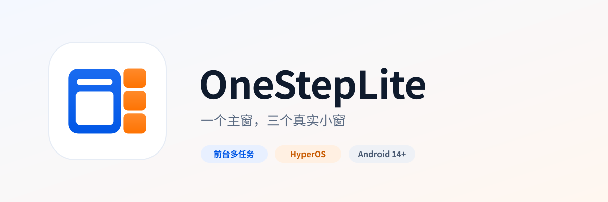
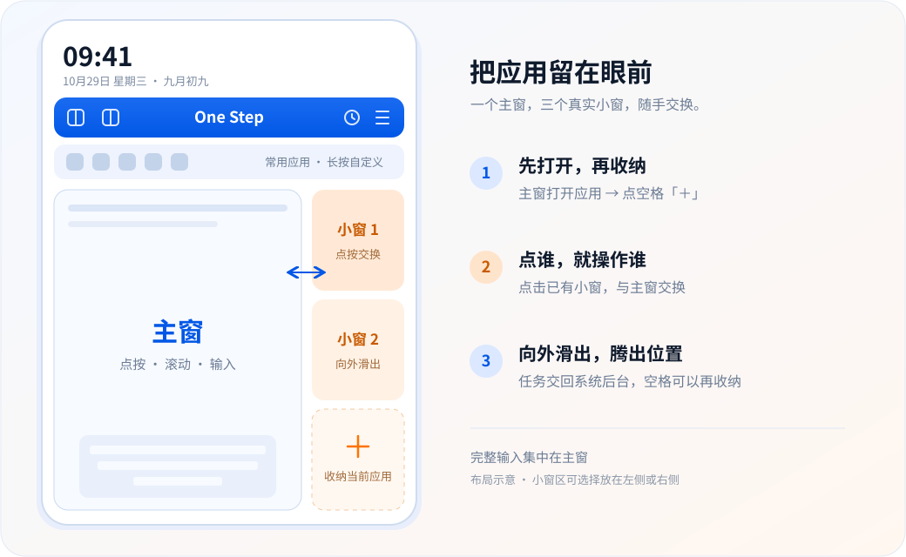
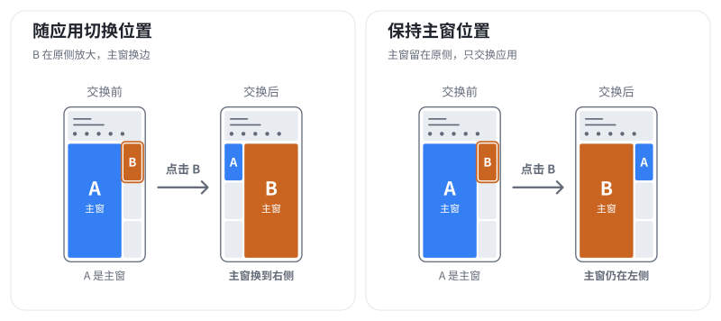

<p align="center">
  
</p>

<p align="center">
  <kbd>1.0.4</kbd> &nbsp; <kbd>Android 14+</kbd> &nbsp; <kbd>HyperOS 2 / 3 / 4</kbd> &nbsp; <kbd>ARM64</kbd> &nbsp; <kbd>Root + LSPosed</kbd>
</p>

<p align="center">
  <a href="#它解决什么问题">它解决什么问题</a> ·
  <a href="#工作区长什么样">工作区长什么样</a> ·
  <a href="#六个操作">六个操作</a> ·
  <a href="#安装">安装</a> ·
  <a href="#设置">设置</a> ·
  <a href="#构建">构建</a> ·
  <a href="#许可">许可</a>
</p>

---

## 它解决什么问题

手机一次只能好好显示一个应用。查资料要回消息，就得切走；看完再切回来，页面可能已经变了。

OneStepLite 把屏幕分成**一个主窗**和**三个小窗**：主窗照常操作，小窗里是系统里真实存在的应用任务，不是截图、不是镜像。想用哪个，点它换到主窗。

它不新建虚拟桌面，也不接管应用本身——只是把已有的任务重新摆到同一屏上。

## 工作区长什么样

<p align="center">
  
  <br><sub>布局示意，不是界面截图；小窗区也可以放在左侧。</sub>
</p>

从上到下是三层：

| 层 | 内容 |
| --- | --- |
| 时钟 | 时间与日期，可在设置里开启农历；文字随背景明暗切换黑白 |
| 标题栏 | `One Step` 标题 + 五个固定按钮，顺序随小窗位置镜像 |
| 常用应用栏 | 固定应用在前，其余按最近使用排列 |

再往下是主窗与三个小窗格。平板横屏时小窗区可扩展到四格。

## 六个操作

### 一、收纳：把当前应用放进空格

先在主窗打开要留下的应用，再点一个空小窗格上的「＋」，它就会进入那个位置。重复几次，工作区就搭好了。

主窗是桌面时会提示先打开应用——空格收纳的是应用任务，不是桌面。

### 二、交换：点谁，就操作谁

点击已有小窗，它进入主窗，原来的主应用退到小窗区。用完再点另一个，继续接着做。

主窗保持输入焦点；交接时有一段短暂的输入保护，避免误触或键盘跑到小窗上。

交换有两种模式，在设置里选：

| 模式 | 行为 |
| --- | --- |
| 随应用切换位置（默认） | 小窗中的应用在原侧放大，主窗随之换到另一侧 |
| 保持主窗位置 | 主窗不动，只交换主窗与小窗里的应用 |

<p align="center">
  
</p>

从下一次交换开始生效，不会立刻移动当前任务。

### 三、滑出：暂时不用就腾位置

向小窗所在的屏幕外侧滑出——小窗区在左就向左，在右就向右。

滑出后该位置变回空格，**任务交回系统并留在后台，不会结束应用**。之后从桌面、最近任务或常用应用栏都能再打开它。

### 四、常用应用栏：常用的排前面

标题栏下方是常用应用栏。固定过的应用排在最前，其余按最近七天的前台使用情况排列；读不到使用统计时按应用名称稳定排序。

| 操作 | 作用 |
| --- | --- |
| 点击图标 | 在主窗打开；已在小窗时交换已有任务 |
| 左右滑动 | 浏览没露出的图标，松手后带惯性 |
| 长按图标 | 打开应用选择框，可搜索、可多选，可长按已选图标拖动排序 |
| 再长按并取消勾选 | 移除固定项，其余继续按常用顺序排列 |

配置按系统用户保存，退出工作区或重启后保留。已选图标也支持无障碍的「向前移动」「向后移动」操作。

设置中可开启「切换应用时收纳原主窗」（默认关闭）：点击常用应用栏打开其他应用时，先将原主窗收入空小窗，确认交接后再打开新应用；没有空位时正常切换。已在小窗内的应用仍直接交换。

### 五、标题栏：五个按钮

| 按钮 | 作用 |
| --- | --- |
| 放大为全屏并退出工作区 | 关闭工作区，回到普通系统界面。箭头指向小窗所在的一侧 |
| 系统设置 | 在主窗打开系统设置 |
| 把主窗应用放到顶栏 | 把当前主窗应用送进顶部横屏任务面，只有横屏应用可用 |
| 小窗放在左侧 | 小窗区移到左边，主窗换到右侧 |
| 小窗放在右侧 | 小窗区移到右边，主窗换到左侧 |

按钮顺序跟着小窗位置走：小窗在左时，左边是放大和设置，右边是放到顶栏和两个换边按钮；小窗在右时整排镜像。**已经在小窗那一侧的换边按钮会置灰**，因为再点没有意义。

标题文字与按钮图标按各自所在位置的壁纸明暗显示黑色或白色；「把主窗应用放到顶栏」在主窗应用为竖屏时置灰，切换到横屏后恢复可用。

### 六、顶部横屏任务面：再留一个可操作的应用

顶部区域可以再放一个能直接操作的应用，与主窗、三个小窗并存。

- 用标题栏的「把主窗应用放到顶栏」把当前横屏应用送上去，进入和退出都是淡入淡出，不翻面。
- 顶部内容淡入覆盖原有时钟、标题栏和常用应用栏；原内容始终保留在下层，空闲时不显示空白页或「＋」。
- 右下角退出按钮随顶部画面一起淡出。手动送入的应用回到主窗，自动接入的视频回到系统原生播放器小窗。
- 手动顶栏任务优先；它占用顶部时，新出现的视频小窗保留在系统里，不抢占现有任务。
- 视频控制按钮常驻右下角，与手动置顶的退出按钮保持相同大小和边距；支持完整显示与填满顶栏两种比例。
- 应用方向变化不会自动占用顶部。
- 顶部任务面没有手势：进出都只走标题栏按钮和右下角退出按钮。

## 横屏应用：全屏时怎么让位

任何应用或游戏进入横屏全屏时，工作区都可以选择怎么处理。设置里的「横屏应用显示位置」有两档，每档都配示意图：

| 选项 | 行为 |
| --- | --- |
| 在主窗中显示（默认） | 应用在主窗内横屏显示，小窗仍可用 |
| 退出工作区，全屏显示 | 退出工作区，用应用原有的全屏界面 |

想让它占满顶部时，用标题栏的「把主窗应用放到顶栏」按钮手动送上去；播放器自己弹出的悬浮小窗会被自动接进顶栏，不需要设置。从下一次进入横屏全屏开始生效。

## 打开工作区的手势

从**左上角向右**滑，小窗区在左；从**右上角向左**滑，小窗区在右。也可以随时用标题栏按钮切换。

手势本身有两种，在设置里选：

| 模式 | 行为 |
| --- | --- |
| 状态栏向内滑（默认） | 从状态栏左侧或右侧向屏幕中间滑 |
| 底部向外滑 | 从屏幕底部任意位置向左或右滑；需先在系统设置里关闭手势提示线 |

沉浸全屏中要先拉出原生状态栏，保持通知与快捷面板未展开，再另起角部手势；没拉出时会拒绝。横屏同样适用。

应用在一步主窗内进入横屏时，工作区会协调页面方向、触摸映射、主窗与小窗交换和悬浮键盘位置。这里的横屏指**一步区域内的应用横屏**；不同应用的横屏策略、输入法和系统版本仍可能带来差异。

## 安装

### 运行环境

| 项目 | 要求 |
| --- | --- |
| 系统 | 最低 **Android 14 / API 34**；适配 HyperOS 2 / 3 / 4 |
| 架构 | **ARM64** |
| 框架 | 可用的 **Root + LSPosed** |
| 开发验证设备 | Xiaomi 17 Pro Max、Redmi Note 11T Pro |

同机型不同 ROM 也可能有接口差异，适配范围不等于全机型兼容承诺。

### 四步启用

包名固定为 `io.github.zerohomers0.onesteplite`。装过旧包名版本时，先退出工作区、在 LSPosed 里停用旧模块，再装这个包、启用新模块、重选作用域，最后正常重启；确认正常后再卸载旧模块。旧包名无法直接覆盖升级，别同时启用两个模块。

1. 从 [发行页](https://github.com/ZeroHomers0/OneStepLite/releases) 下载 `OneStepLite-1.0.4.apk`，可用同页 `SHA256SUMS.txt` 核对。
2. 安装后在 LSPosed 里启用 **OneStepLite**，选推荐作用域。
3. **正常重启手机**，让系统进程加载模块。
4. 竖屏下用上角横滑打开工作区，先在主窗开一个应用，再点空格「＋」收纳。

推荐作用域：

| 作用域 | 包名 | 说明 |
| --- | --- | --- |
| 系统框架 | `android` | 系统任务、主窗缩放与输入适配 |
| 系统界面 | `com.android.systemui` | 工作区、标题栏与原生控件 |
| 设置 | `com.android.settings` | 只提供系统设置首页的入口 |

用小米输入法且需要阻止横屏时自动变悬浮键盘，可另选 `com.xiaomi.type`——这是输入法内部策略的可选兼容项，普通显示和输入不依赖它。「设置」只用于模块入口，播放器不需要加入作用域。升级不会替你清掉 LSPosed 里保存的旧勾选，多余的可自行取消。

### 第一次搭工作区

主窗开浏览器，点空格「＋」收纳；再开笔记，收进第二格；然后回到聊天应用。现在可以看着资料回消息，点笔记换到主窗补几句，再点聊天换回来。要腾位置就把暂时不用的小窗向外滑出。

## 设置

从 **系统设置 → OneStepLite** 打开，入口在「我的设备」下方，没有独立桌面图标。界面跟随系统浅色/深色主题。

| 分组 | 设置项 |
| --- | --- |
| 外观 | 显示农历 |
| 窗口与操作 | 打开工作区的手势、主窗与小窗交换方式、滚动浏览小窗、在最近任务中隐藏小窗应用、切换应用时收纳原主窗 |
| 横屏 | 横屏应用显示位置 |
| 锁屏 | 解锁后恢复工作区 |

- **滚动浏览小窗**：上下滑动小窗区域，查看更多小窗。
- **在最近任务中隐藏小窗应用**：只在 OneStepLite 打开时生效，不会关闭应用。
- **解锁后恢复工作区**：开启后解锁恢复原有窗口布局；关闭后解锁回到普通全屏界面。

选择保存在本机，退出或重启后保留。

## 构建

需要 JDK 17+、Android SDK（`compileSdk 37`、`build-tools 36.0.0`）与 NDK `28.2.13676358`。`local.properties` 里的 `sdk.dir` 指向本机 SDK。

```bash
# 调试包
./gradlew :app:assembleDebug

# 未签名发行包 + 包结构校验 + dist/ 校验和
./gradlew :app:stageRelease

# 离线测试：策略单测 + 生产方法回放 + 包检查
powershell -NoProfile -ExecutionPolicy Bypass -File ./test.ps1
```

`stageRelease` 依次执行 `assembleRelease`、`verifyApk`（校验入口类、Xposed 资产、许可文件与未压缩的 ARM64 原生库）和 `stageRelease`（复制到 `dist/` 并写 `SHA256SUMS.txt`）。签名用环境变量提供，仓库里不含私钥：

| 变量 | 用途 |
| --- | --- |
| `ONESTEPLITE_KEYSTORE` | 密钥库路径；未设置时发行包保持未签名 |
| `ONESTEPLITE_KEY_ALIAS` | 密钥别名 |
| `ONESTEPLITE_STORE_PASSWORD` | 密钥库口令 |
| `ONESTEPLITE_KEY_PASSWORD` | 密钥口令 |

`test.ps1` 会自己编译生产源码，再依次跑 `tests/` 的策略单测、`tools/` 的生产方法回放套件和 `tools/rotation-jvm/` 的窗口管理测试。全通过时输出 `All offline tests passed. Device behavior requires separate validation.`——离线测试只证明逻辑等价，真机行为仍需单独验证。

`build.ps1` 是保留的等价参考实现（aapt2 + d8 + zipalign + apksigner 手工链路），用来交叉核对 Gradle 产物；日常开发用 Gradle。

### 持续集成

`.github/workflows/build.yml` 只在合并进 `main`（或推送 `v*` 标签）时运行，分支提交与拉取请求不触发：

| 作业 | 环境 | 内容 |
| --- | --- | --- |
| `apk` | `ubuntu-latest` | 装 `platforms;android-37.0`、`build-tools;36.0.0`、`ndk;28.2.13676358`，跑 `:app:lintRelease :app:stageRelease`，上传 APK 与 `SHA256SUMS.txt` |
| `tests` | `windows-latest` | 跑 `test.ps1`，51 个策略单测与 100 个生产方法回放套件 |

每次 `main` 构建成功后，`latest` 作业把产物刷新到 [`latest` 预发布](https://github.com/ZeroHomers0/OneStepLite/releases/tag/latest)——那里是普通文件、有固定直链，手机能直接下载；推 `v*` 标签时 `release` 作业另外发正式版。

> Actions 页面的 Artifact 也能下，但 GitHub 规定必须登录、而且永远是 zip，日常取包用 `latest` 更省事。

发行签名通过仓库 Secrets 提供；没配时普通构建产出未签名包，标签构建会直接失败。

| Secret | 用途 |
| --- | --- |
| `ONESTEPLITE_KEYSTORE_BASE64` | 密钥库文件的 Base64 内容 |
| `ONESTEPLITE_KEY_ALIAS` | 密钥别名 |
| `ONESTEPLITE_STORE_PASSWORD` | 密钥库口令 |
| `ONESTEPLITE_KEY_PASSWORD` | 密钥口令 |

四个 Secret 已配置，`latest` 与标签发行都是已签名包。证书指纹（SHA-256）：

```
7A:89:9B:AA:E7:0F:CF:D8:6A:B1:D8:8A:B9:F3:01:59:5D:6E:0E:AD:7A:8D:4B:ED:01:C6:DA:C4:87:04:60:F9
```

> 密钥库不在仓库里，只在本机 `.local/keystore/onesteplite-release.jks` 与仓库 Secrets。**丢失后无法覆盖安装**，请自行备份；换签名后已装版本必须先卸载。

`apk` 作业用 `tools/assert_module_apk.py` 校验产物，与本地 `verifyApk` 是同一份逻辑。

Lint 也在 CI 里跑。`app/lint.xml` 关掉对 LSPosed 模块不适用的检查（`PrivateApi`、`MissingPermission`、`WrongConstant` 等），其余历史问题记在 `app/lint-baseline.xml`；新增问题会让构建失败。确认某条基线失效后用 `./gradlew :app:updateLintBaseline` 重新生成。

## 项目结构

```
app/src/main/java/io/github/zerohomers0/onesteplite/   184 个源文件，按功能分 17 个子目录
app/src/main/cpp/                                      原生输入映射（ARM64）
app/src/main/res/                                      图标与主题
app/src/main/assets/                                   模块入口与许可文件
tests/                                                 51 个策略单测
tools/                                                 100 个生产方法回放套件
```

目录职责、分层约定、命名与代码风格、改动时必须遵守的等价性约束，见[项目结构与代码规范](docs/项目结构与代码规范.md)。

## 参考与致谢

| 项目 | 关系 |
| --- | --- |
| [SmartisanTech / android](https://github.com/SmartisanTech/android) | 锤子科技官方开源入口；One Step 的交互思路是本项目的参考起点 |
| [SangLuoCN / OneStep4](https://github.com/SangLuoCN/OneStep4) | 社区作品，促成本项目动手尝试 |
| [Van Step](https://github.com/Xposed-Modules-Repo/com.hyper.sidebar) | 社区作品，促成本项目动手尝试 |
| [NeXtep](https://github.com/ZeroHomers0/NeXtep) | 视频窗口接入与壁纸快照的实现参考 |

OneStepLite 是个人项目，不是小米、锤子科技或上述社区项目的官方产品。致谢表示体验与创作启发，不代表它们参与开发、背书或提供兼容保证。第三方组件与许可全文见 APK 内的 `assets/onesteplite/licenses/`。

## 许可

**允许非商用分享，禁止商业化，分发衍生版本必须公开完整对应源码并沿用同一许可。**

| 你想做的事 | 规则 |
| --- | --- |
| 自己用、学习，或改完自用 | 允许非商用使用；只给自己用的修改无须公开 |
| 免费转发原版或发布改进版 | 保留署名与许可，提供该版本完整对应源码 |
| 换名字、换界面后卖钱 | 禁止 |
| 付费下载、会员解锁、广告变现、收费捆绑 | 禁止 |
| 改完闭源分发 | 禁止 |

本项目采用自定义的 **OneStepLite 非商用共享源码许可 1.0**，准确归类为**源码公开（Source Available）**。因为限制商业化，它不属于 OSI 定义的开源许可，也不是 GPL-3.0——GPL-3.0 本身允许商用和收费分发。完整条件见 [LICENSE](LICENSE)。

第三方组件保留各自许可；公开源码不包括签名私钥、账号凭据或设备个人材料。

---

<p align="center"><strong>OneStepLite</strong><br><sub>把想法讲出来，把体验做出来，再一起往前走一步。</sub></p>
