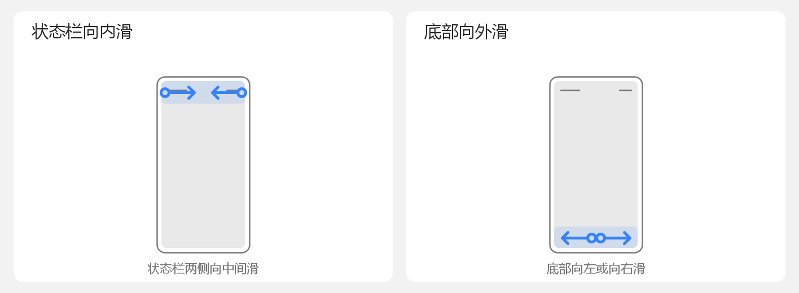
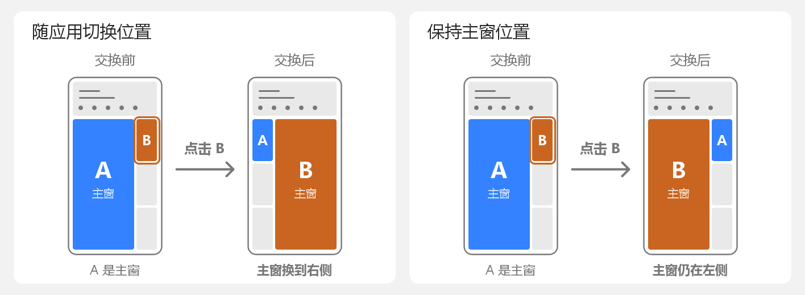
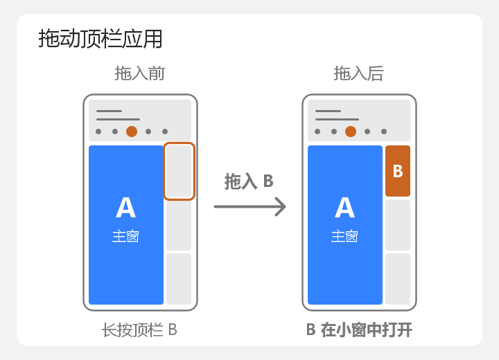
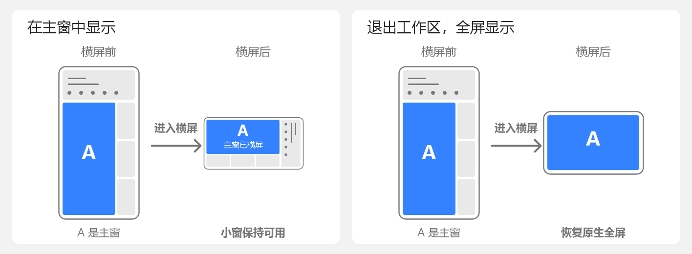

# OneStepLite

OneStepLite 是面向小米 HyperOS 的 LSPosed 多任务模块。工作区包含一个主窗和三个真实小窗，平板横屏最多显示四个小窗。可以边看视频、网页或聊天，边切换任务、暂存内容或拖曳分享。

[下载正式版](https://github.com/ZeroHomers0/OneStepLite/releases/latest) · [反馈问题](https://github.com/ZeroHomers0/OneStepLite/issues) · [项目规范](docs/项目结构与代码规范.md)

## 安装与首次打开

1. 准备 ARM64、Android 14 或更新版本的设备，取得 Root 并安装设备可用的 LSPosed 兼容框架。项目主要适配小米 HyperOS，既有真机验证环境为 Android 17 / HyperOS 4。
2. 安装正式 APK。在 LSPosed 启用模块，勾选推荐作用域「系统框架」「系统界面」「系统设置」「内容提取服务」「传送门」，然后重启。
3. 从状态栏左侧或右侧向中间滑动，打开工作区。首次配置可从系统设置里的「OneStepLite」进入。
4. 可在「窗口与操作 → 打开工作区的手势」改为从底部向左或向右滑动。底部导航指示条被隐藏时，按设置页提示使用状态栏手势。

更新可用同一签名的正式 APK 覆盖安装。出现系统界面异常时，可在 LSPosed 停用模块并重启。Android 版本达到最低要求仍需核对 ROM 兼容性。

## 管理主窗与小窗

| 想做什么 | 怎么操作 |
| --- | --- |
| 把当前应用收进小窗 | 点空小窗里的「＋」 |
| 将小窗应用切到主窗 | 点一下已有的小窗 |
| 调整小窗顺序 | 长按已有小窗，拖到另一个已有小窗，高亮后松手交换 |
| 直接从应用栏打开小窗 | 长按快捷应用图标，拖到高亮的空小窗后松手 |
| 移出小窗 | 把小窗向所在侧的屏幕外滑，应用继续留在后台 |
| 把主窗和小窗区域整体换边 | 点顶栏的左侧或右侧布局按钮 |

在「窗口与操作 → 主窗与小窗交换」可选择随应用切换位置，或保持主窗位置。也可开启滚动浏览小窗、切换时收纳主窗。

## 内容、截图与拖曳分享

- **从内容面板分享**　点顶栏内容图标，打开图片、文件、剪贴板或暂存。长按条目可拖到分享栏，也可多选后一起拖曳。「更多文件」使用系统文件选择器。
- **从应用画面提取**　单指长按文字或图片，稍停后明确移动。能取得内容时优先提起拖曳窗，原地松手取消。有标准文字选择菜单的应用也可用「拖曳到一步」提起选区。
- **截取当前画面**　点顶栏四角截图图标，框选主窗并点「使用选区」，再长按结果拖曳。双指停留可尝试选词、图片预览或截图识字，截图识字排除状态栏。
- **投递或稍后处理**　把箭头尖端对准分享入口，高亮后松手。支持暂存、搜索、翻译、地图、图片编辑、图片搜索及接收应用提供的入口。必应图片搜索会把所选图片上传至必应，并在内置页面显示结果。
- **拖到小窗**　支持接收拖放的应用可接收相应内容，文字可投向兼容输入框。同来源窗口或同应用小窗松手默认取消。图片和文件能否接收取决于目标应用。

在「内容分享」可开关拖曳分享。在「顶栏 → 管理分享入口」可启用、搜索和调整入口顺序。系统提取覆盖不足时，可在 LSPosed 为来源应用额外启用作用域并重载进程，尝试从标准控件或暴露语义的自定义控件提取。仅绘制画面的页面可使用截图或识字。跨应用提取、投递和接收仍需在对应 HyperOS 与目标应用组合上验证。

## 横屏、视频与个性化

- 主窗页面支持横屏时，可点顶栏置顶按钮在顶部内容区打开，退出后返回主窗。高德、百度地图等导航应用也可使用顶部横屏视口。符合条件的悬浮视频可自动接入，退出后还原播放器小窗。
- 「横屏 → 横屏应用显示位置」可选在工作区内显示横屏应用，或退出工作区后全屏显示。
- 「顶栏 → 管理快捷应用」可搜索、启用和长按排序。图标上的绿色小点表示应用已在工作区打开。
- 「外观」可设置时间、日期、农历、主题、工作区背景及顶栏是否随窗口换边。「锁屏」可设置解锁后恢复工作区。

## 开发与反馈

构建需要 JDK 21、Android SDK 和 Python 3。运行 `./gradlew :app:lintRelease :app:stageRelease :app:testDebugUnitTest` 和 `./test.ps1`，产物位于 `dist/`。正式 APK 由仓库 CI 签名发布。

- [项目结构与代码规范](docs/项目结构与代码规范.md)
- [界面与交互规范](docs/界面与交互规范.md)
- [系统与平台规范](docs/系统与平台规范.md)

提交问题时请提供设备型号、Android / HyperOS 版本、模块版本和复现步骤。有画面问题可附录屏，有框架问题可附相关模块日志。分享前请移除个人信息。 [提交 Issue](https://github.com/ZeroHomers0/OneStepLite/issues)

## 许可

项目采用 [非商用共享源码许可](LICENSE)。第三方组件及衍生内容见 [第三方声明](app/src/main/assets/onesteplite/licenses/THIRD_PARTY_NOTICES.md)。
